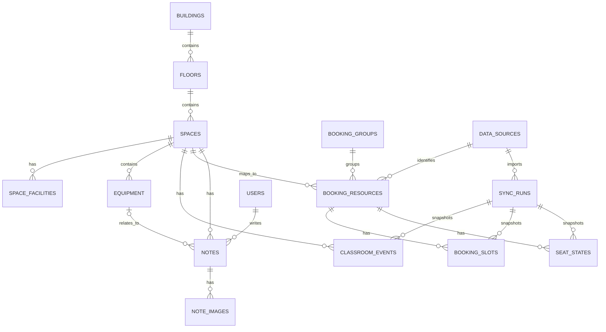

# CampusSpace 数据库与页面对应

项目使用 Room 管理本地 SQLite，数据库文件为 `campus.db`，当前版本为 3。持久化模型位于 `data/store/Rows.java`，页面模型位于 `data/entity`，由 `Repo` 负责转换。完整字段与索引以 `app/schemas/com.xjtlu.campusspace.data.AppDatabase/3.json` 为准；附加数据校验由 `SchemaV2` 与 `AuthMigration` 的 SQLite 触发器执行。

[schema.sql](schema.sql) 是从通过 Android 验证的数据库导出的建库脚本，仅含表、索引和完整性触发器，不含用户或演示记录。

## 表结构

除设施标签表外，各表都有非空字符串主键 `id`。时间均为 Unix 毫秒，时间区间采用左闭右开 `[starts_at, ends_at)`；页面统一使用校园时区 `Asia/Shanghai` 转换日期，避免设备时区影响课表。实体字段为 Java camelCase，数据库列为 snake_case。

| 表 | 字段及关系 | 主要约束 |
|---|---|---|
| buildings | id, code, name, campus_zone, sort_order | code 唯一 |
| floors | id, building_id → buildings, code, sort_order | 楼栋内 code 唯一；可显示 B1、1F 等，不以标签字符串排序 |
| spaces | id, floor_id → floors, code, name, type, location_hint, show_in_public_list, capacity, size, sub_type | 楼层内 code 唯一；容量非负；同一物理空间只保存一次 |
| space_facilities | space_id → spaces, facility_code | 两列组成主键；保存多媒体、白板、空调等标签 |
| equipment | id, space_id → spaces, type, name, location_hint | 保存饮水机、打印机等独立设备 |
| classroom_events | id, space_id → spaces, sync_run_id → sync_runs, external_occurrence_id, starts_at, ends_at, course, teacher | 同批外部课次 ID 唯一；课次必须处于批次窗口、属于该空间 |
| booking_groups | id, category, label, display_mode, sort_order | category + label 唯一；分类与显示模式匹配 |
| booking_resources | id, group_id → booking_groups, space_id → spaces, source_id → data_sources, external_id, label, grid_row, grid_col, official_url | 来源内 external_id 唯一；座位网格坐标在分组内唯一 |
| booking_slots | id, resource_id → booking_resources, sync_run_id → sync_runs, starts_at, ends_at, status, raw_status | 同批同资源时间区间唯一；来源、分组、窗口与批次一致 |
| seat_states | id, resource_id → booking_resources, sync_run_id → sync_runs, status, raw_status | 同批同资源唯一；查询窗口来自批次 |
| data_sources | id, code, name, default_booking_url, is_demo | code 唯一；区分演示与实际数据来源 |
| sync_runs | id, source_id → data_sources, data_kind, scope_key, window_start, window_end, fetched_at, status | 正有效时间窗口；数据类型和状态采用受控枚举 |
| users | id, auth_subject 可空, display_name, username 可空, password_hash, password_salt, password_algorithm, password_iterations, created_at, failed_attempts, locked_until, rules_accepted_at | 本机用户名不区分大小写且唯一；旧匿名作者保持 username=NULL；密码加盐派生；限流与规则同意时间持久化 |
| notes | id, space_id → spaces, author_id → users, equipment_id 可空, type, body, created_at, status | 正文非空；设备与空间通过复合外键保证一致；按空间/设备/时间建索引 |
| note_images | id, note_id → notes, object_key, sort_order | 同纸条展示序号唯一；删除纸条时级联删除图片记录 |

空间类型：`CLASSROOM`、`PUBLIC_REST`、`OPEN_SEATING`、`DISCUSSION_ROOM`、`QUIET_POD`、`LIBRARY_AREA`、`PUBLIC_AREA`。讨论区使用教室的 `sub_type=DISCUSSION_AREA`，因此它可以同时显示在教室页和讨论区分类。设备所属的楼层公共区域使用隐藏的 `PUBLIC_AREA`，不会冒充一个教室。

## 实体关系



一个讨论室通常映射一个预约资源；一个图书馆座位区映射多个座位资源，因此 `booking_resources.space_id` 不设一对一限制。设备纸条必须同时关联设备所在空间，普通纸条允许不选设备。

## 页面读取规则

| 页面 | 数据来源与行为 |
|---|---|
| 首页教室 | buildings → floors → spaces(type=CLASSROOM)，用所选日期的有效 classroom_events 计算状态 |
| 首页公共空间 | spaces.show_in_public_list；休息处、开放座位区、讨论区、讨论室、静音仓、图书馆区域共享物理空间 ID |
| 教室详情 / 讨论区 | TIMELINE 模式，使用具体日期课次；保留设施、容量、课程及教师字段 |
| 讨论室 / 静音仓 | 数据驱动的 booking_groups + booking_resources，SLOTS 模式读取有效批次时段 |
| 图书馆座位 | SEATS 模式，按资源 grid_row / grid_col 排列；按所选日期匹配批次窗口 |
| 公共设备 | 饮水机、打印机取 equipment；休息处、开放座位区取 spaces；楼栋和楼层均从数据库生成 |
| 纸条 | 具体空间下的 notes；设备入口可进一步筛 equipment_id；发布与图片记录保存采用事务 |

游客可以查询空间。发布前必须登录本机账号，再选择有效具体空间，禁止将 `FB` 这样的楼栋代码写入空间 ID。详情页自动带入空间，发布后返回刷新。纸条作者在写入事务中从会话取得，不接受页面伪造的 author_id。我的纸条按当前账号查询，退出后清空个人视图；旧匿名纸条继续保留，不自动归给新账号。数据库与发布页支持最多 4 张图片，并按展示顺序保存。

## 同步与未知状态

`SnapshotImporter.publish` 负责完整批次的验证和事务发布。成功标记和所有子记录一起提交；任意一项出错则全部回滚。成功空结果也会成为有效批次，页面不会因没有子记录而回退到更旧的数据。

`EVENTS` 的 scope_key 是空间 ID，`SLOTS` 和 `SEATS` 的 scope_key 是分组 ID。页面按来源、数据类别、scope、查询日期窗口选择最新成功完整批次，并检查 24 小时有效期。每个查询只使用一个批次，不逐行拼接不同批次。

无覆盖、已过期、未知上游状态均显示“未知”，不能据此判断空闲。规范化时段状态为 `FREE / BOOKED / UNKNOWN`，座位为 `AVAILABLE / PART_FREE / RESERVED / UNAVAILABLE / UNKNOWN`。原始状态保存在 raw_status。教室“无课”只有在有效完整课表批次存在时才解释为空闲，且仍然只代表课表安排。

## 种子、演示范围与真实接口

`catalog.json` 补齐需求中列出的 15 个楼栋条目和 LIB 图书馆；没有空间资料的楼栋显示空列表，不生成虚构房间或课表。`seed.json` 继续作为演示模板，首次启动转换成规范化资源与具体日期记录。演示刷新按日生成新批次，保留原批次与用户内容，方便验证历史来源。

演示课表覆盖昨天至未来 7 天；预约时段覆盖昨天至后天；座位模板只描述今天，其他日期显示未知。页面标明演示数据。原种子的学校官网首页占位链接不会当作真实预约入口；在 `booking_resources.official_url` 或来源的 `default_booking_url` 配置实际链接后，按钮才可跳转。

项目没有获授权的官方 API 地址或认证信息，因此本次提供同步存储与原子导入能力，不进行学校系统抓取。后续连接器将上游数据转换为 Rows 和完整 Snapshot 后调用导入器，再重新加载 Repo 即可；不会增加 App 内预约交易。

## v1 升级与验证

版本 1 升级为 2 使用显式迁移，不再使用破坏性回退。旧周课表和相对预约时段转换为绝对日期，旧纸条正文、时间、昵称、图片路径保留。旧版误绑楼栋的纸条迁移到明确命名的楼栋公共区域，既保留内容也恢复有效外键。

版本 2 升级为 3 为 users 增加本机账号字段，保留所有旧作者及纸条。新注册账号使用独立 ID，不能通过同名昵称认领旧纸条。账号规则与数据边界见 [本机账号说明](local-accounts.md)。

验证命令：

```powershell
$env:JAVA_HOME = 'C:\Program Files\Android\Android Studio\jbr'
.\gradlew.bat assembleDebug testDebugUnitTest
.\gradlew.bat connectedDebugAndroidTest
```

本机 Windows 用户目录含中文且 Java native.encoding 为 GBK 时，Gradle 9.6 的测试启动参数文件可能出现编码不匹配。可仅对该次验证覆盖 daemon 编码，不修改系统设置：

```powershell
.\gradlew.bat testDebugUnitTest --no-daemon --no-configuration-cache '-Dorg.gradle.jvmargs=-Xmx2048m -Dfile.encoding=GBK'
```

Java 源码编译已显式指定 UTF-8，不受上述临时测试启动编码影响。

单元测试检查批次选择、范围、过期、来源隔离和夏令时日界。Android 测试检查首次灌库、重复启动、外键与唯一约束、批次事务回滚，以及实际 Room 版本迁移验证与纸条图片保留。
